<div align="center">

# 🚀 ToggleMaster · DevOps & Cloud Architecture Journey

**Plataforma de Feature Flags · Fase 4: Observabilidade Total e Resposta Ativa**


</div>

---

## 📑 Índice

- [🛤 Sobre o Projeto (Visão Evolutiva)](#-sobre-o-projeto-visão-evolutiva)
- [🎯 O Desafio da Fase 4](#-o-desafio-da-fase-4)
- [🏗 Arquitetura da Solução](#-arquitetura-da-solução)
  - [O caminho da telemetria](#o-caminho-da-telemetria)
  - [A cadeia de resposta a incidentes](#a-cadeia-de-resposta-a-incidentes)
- [🧩 Os 5 Microsserviços](#-os-5-microsserviços)
- [🟠 Requisito 1 · Stack de Monitoramento Open Source](#-requisito-1--stack-de-monitoramento-open-source)
- [🟡 Requisito 2 · OpenTelemetry Collector](#-requisito-2--opentelemetry-collector)
- [🟢 Requisito 3 · Instrumentação e APM (New Relic)](#-requisito-3--instrumentação-e-apm-new-relic)
  - [Serviços em Python](#serviços-em-python)
  - [Serviços em Go](#serviços-em-go)
  - [O resultado no New Relic](#o-resultado-no-new-relic)
- [🔴 Requisito 4 · Alertas, Incidente, ChatOps e Self-Healing](#-requisito-4--alertas-incidente-chatops-e-self-healing)
  - [Alertas por nível de severidade](#alertas-por-nível-de-severidade)
  - [Roteamento e inibição no Alertmanager](#roteamento-e-inibição-no-alertmanager)
  - [Incidente e ChatOps](#incidente-e-chatops)
  - [Self-healing](#self-healing)
  - [A prova real](#a-prova-real)
- [🧭 Justificativa Técnica das Escolhas](#-justificativa-técnica-das-escolhas)
- [✅ Rastreabilidade dos Requisitos](#-rastreabilidade-dos-requisitos)
  - [Código-fonte no repositório](#código-fonte-no-repositório)
  - [Vídeo de demonstração](#vídeo-de-demonstração)
  - [Relatório de entrega](#relatório-de-entrega)
- [🚀 Como Reproduzir do Zero](#-como-reproduzir-do-zero)
  - [1. Recursos persistentes (uma única vez)](#1-recursos-persistentes-uma-única-vez)
  - [2. Infraestrutura do ambiente](#2-infraestrutura-do-ambiente)
  - [3. Segredos e bootstrap](#3-segredos-e-bootstrap)
  - [4. Ensaiar e provocar o incidente](#4-ensaiar-e-provocar-o-incidente)
  - [5. Derrubar o ambiente](#5-derrubar-o-ambiente)
- [🚧 Desafios e Decisões Técnicas](#-desafios-e-decisões-técnicas)
- [💰 Disciplina de Custo (FinOps)](#-disciplina-de-custo-finops)
- [📦 Entregáveis da Fase 4](#-entregáveis-da-fase-4)
- [🏷 Versionamento](#-versionamento)
- [👤 Autor](#-autor)

---

## 🛤 Sobre o Projeto (Visão Evolutiva)

Para espelhar cenários reais da indústria, o ToggleMaster evolui em fases, mantidas no mesmo repositório e marcadas com Git Tags:

- ✅ **`v1.0.0-fase1`:** MVP monolítico (Python/Flask) em EC2 com RDS privado.
- ✅ **`v2.0.0-fase2`:** reescrita em 5 microsserviços conteinerizados, orquestrados no Amazon EKS, com escalabilidade automática.
- ✅ **`v3.0.0-fase3`:** a mesma plataforma 100% como código: infraestrutura em Terraform, CI com portões de segurança (DevSecOps) e entrega declarativa via GitOps com ArgoCD.
- 🔵 **`v4.0.0-fase4` `[ATUAL]`:** a plataforma ganha **visibilidade e capacidade de reação**. Métricas, logs e traces coletados pelo OpenTelemetry, um APM com tracing distribuído, e uma cadeia de resposta que transforma um alerta em incidente, avisa a equipe e aciona uma automação capaz de corrigir o problema sozinha.

> A Fase 4 é aditiva: toda a base das fases anteriores continua de pé (Terraform, pipelines DevSecOps, GitOps com ArgoCD) e é justamente por ela que a nova stack chega ao cluster. Nada da observabilidade foi instalado à mão.

---

## 🎯 O Desafio da Fase 4

O enunciado parte de um problema concreto: a plataforma funciona, mas quando algo quebra a equipe descobre pelo cliente. Ele pede quatro entregas:

1. **Stack de monitoramento open source** no cluster, via GitOps: Prometheus para métricas, Loki para logs e Grafana para visualização, com pelo menos um dashboard customizado.
2. **OpenTelemetry Collector** como peça central, recebendo a telemetria das aplicações e roteando cada sinal ao seu destino.
3. **Instrumentação das aplicações** com OpenTelemetry e um **APM comercial** (Datadog ou New Relic) exibindo o Service Map e traces distribuídos.
4. **Resposta ativa a incidentes:** alertas inteligentes, abertura de incidente (PagerDuty ou OpsGenie), notificação em ChatOps (Slack, Discord ou Teams) e uma automação de **self-healing** que execute a ação corretiva.

---

## 🏗 Arquitetura da Solução

### O caminho da telemetria

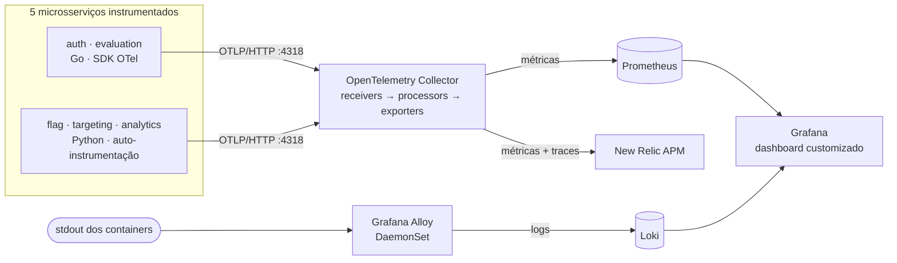

As aplicações conhecem um único destino, o Collector. É ele que decide para onde vai cada sinal, então trocar de APM é uma mudança de configuração, e não de código.

### A cadeia de resposta a incidentes

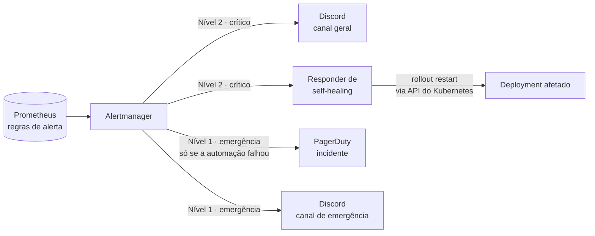

O desenho segue a linha do tempo ensinada nas aulas de Automação de Incidentes: primeiro a automação tenta resolver, e o plantonista só é acionado se ela não for suficiente.

---

## 🧩 Os 5 Microsserviços

| Serviço | Linguagem | Responsabilidade | Instrumentação |
|---|---|---|---|
| **auth-service** | Go | Emite e valida chaves de API | SDK OTel, `otelhttp` no servidor |
| **flag-service** | Python | CRUD das feature flags | auto-instrumentação (Flask, psycopg2) |
| **targeting-service** | Python | Regras de segmentação | auto-instrumentação (Flask, psycopg2) |
| **evaluation-service** | Go | Decisão final `true/false`, produz evento | SDK OTel com propagação de contexto em todas as chamadas |
| **analytics-service** | Python | Consome eventos da SQS e grava no DynamoDB | auto-instrumentação (boto3, threading) |

---

## 🟠 Requisito 1 · Stack de Monitoramento Open Source

Toda a stack entra no cluster como **Applications do ArgoCD**, declaradas em [gitops/apps/](gitops/apps/), pelo mesmo fluxo GitOps dos microsserviços.

| Componente | Implementação | Onde |
|---|---|---|
| **Prometheus, Alertmanager e Grafana** | chart `kube-prometheus-stack` 91.4.1, com retenção de 5 dias | [kube-prometheus-stack.yaml](gitops/apps/kube-prometheus-stack.yaml) |
| **Loki** | chart `loki` 7.3.0 em modo SingleBinary, armazenamento em filesystem | [loki.yaml](gitops/apps/loki.yaml) |
| **Coleta de logs** | Grafana Alloy 1.12.1 como DaemonSet, lendo a saída de todos os pods | [alloy.yaml](gitops/apps/alloy.yaml) |
| **Alvos de coleta** | ServiceMonitors do ingress-nginx e do OTel Collector | [gitops/base/observability/](gitops/base/observability/) |
| **Dashboard customizado** | ConfigMap com o label `grafana_dashboard`, importado sozinho pelo sidecar do Grafana | [dashboard-togglemaster.yaml](gitops/base/observability/dashboard-togglemaster.yaml) |
| **Fonte de logs no Grafana** | datasource do Loki com `uid` fixo, para o painel de logs referenciar sem ambiguidade | [kube-prometheus-stack.yaml](gitops/apps/kube-prometheus-stack.yaml) |

O dashboard tem sete painéis: uso de CPU e de memória do cluster, taxa de requisições por serviço, erros HTTP por serviço e por código, CPU e memória por pod do namespace da aplicação, e os logs em tempo real vindos do Loki. As métricas de requisição vêm da própria instrumentação OpenTelemetry das aplicações, e não da infraestrutura, então medem o que o usuário de fato experimenta.

Algumas escolhas de configuração merecem registro. Os seletores padrão do chart só enxergam objetos que carreguem o label do próprio release, então `serviceMonitorSelectorNilUsesHelmValues`, `podMonitorSelectorNilUsesHelmValues` e `ruleSelectorNilUsesHelmValues` foram desligados para que ServiceMonitors e regras de alerta do projeto sejam descobertos. A senha de administrador do Grafana vem de um Secret fixo, porque o padrão do chart gera uma nova a cada sincronização do ArgoCD. E a coleta do scheduler e do controller-manager foi desligada, já que no EKS eles fazem parte do plano de controle gerenciado pela AWS e não expõem métricas ao cluster.

<p align="center">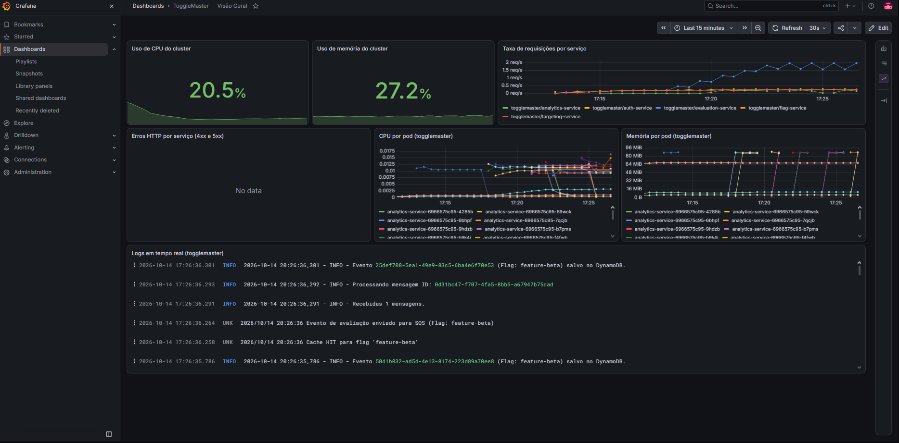</p>

<p align="center">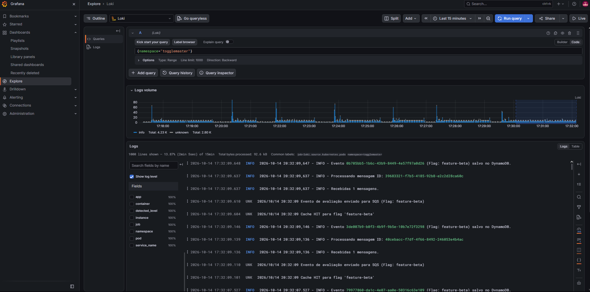</p>

---

## 🟡 Requisito 2 · OpenTelemetry Collector

O Collector é a peça central da arquitetura, instalado pelo chart `opentelemetry-collector` 0.173.1 com a imagem *contrib* ([otel-collector.yaml](gitops/apps/otel-collector.yaml)).

| Etapa | Configuração |
|---|---|
| **Receivers** | `otlp`, em gRPC (`:4317`) e HTTP (`:4318`) |
| **Processors** | `memory_limiter` (protege o Collector sob carga) e `batch` |
| **Exporters** | `prometheus` (expõe em `:8889`, coletado por ServiceMonitor), `otlp/newrelic` (envia em gRPC ao endpoint OTLP do New Relic) e `debug` |
| **Pipeline de métricas** | `otlp` → `memory_limiter`, `batch` → `prometheus` e `otlp/newrelic` |
| **Pipeline de traces** | `otlp` → `memory_limiter`, `batch` → `otlp/newrelic` e `debug` |
| **Pipeline de logs** | `otlp` → `memory_limiter`, `batch` → `debug` (reservado; os logs seguem pelo Alloy, como explicado abaixo) |

A chave do New Relic chega ao Collector por variável de ambiente lida de um Secret (`newrelic-license`), e nunca aparece no repositório.

**Por que os logs seguem por outro caminho.** O Grafana Alloy também é uma distribuição do OpenTelemetry Collector, mas roda como DaemonSet e lê a saída padrão de todos os containers, inclusive dos componentes de terceiros que não foram instrumentados. Para não duplicar logs, as aplicações rodam com `OTEL_LOGS_EXPORTER=none`, e o Alloy é a única origem dos logs no Loki, já com os rótulos de namespace, pod, container e app aplicados na coleta.

As aplicações são apontadas para o Collector por variáveis de ambiente nos Deployments ([exemplo](gitops/base/evaluation-service/deployment.yaml)): `OTEL_SERVICE_NAME`, `OTEL_EXPORTER_OTLP_ENDPOINT`, `OTEL_EXPORTER_OTLP_PROTOCOL=http/protobuf` e `OTEL_RESOURCE_ATTRIBUTES=service.namespace=togglemaster`.

---

## 🟢 Requisito 3 · Instrumentação e APM (New Relic)

### Serviços em Python

Os três serviços Python usam a **instrumentação automática**: o `opentelemetry-distro` 0.66b0 e o exportador OTLP 1.45.0 entram no [requirements.txt](services/flag-service/requirements.txt), o [Dockerfile](services/flag-service/Dockerfile) roda `opentelemetry-bootstrap -a install` para baixar os instrumentadores das bibliotecas presentes, e a aplicação passa a subir com `opentelemetry-instrument gunicorn`. Flask, requests, psycopg2 e, no analytics, boto3 e threading ficam instrumentados sem mudança no código da aplicação.

### Serviços em Go

Os dois serviços Go usam o **SDK** (`otel` v1.46.0 e `otelhttp` v0.71.0). Cada um ganhou um [tracing.go](services/evaluation-service/tracing.go) que configura o TracerProvider e o MeterProvider com exportação OTLP, lendo a configuração das variáveis de ambiente, e registra os propagadores W3C TraceContext e Baggage. O roteador HTTP é envolvido por `otelhttp.NewHandler`.

O ponto que mais exigiu atenção foi o **evaluation-service**, que chama os outros três serviços. Para o trace atravessar essas chamadas, o contexto da requisição precisou ser propagado por toda a cadeia de funções, com `http.NewRequestWithContext` nas chamadas de saída e um cliente HTTP com `otelhttp.NewTransport`, que injeta o cabeçalho `traceparent`. Sem essa refatoração, cada serviço aparecia como um trace isolado de um único span, e o Service Map não se formava.

### O resultado no New Relic

O New Relic recebe OTLP nativamente, então não há agente proprietário em nenhum serviço. Os cinco aparecem como entidades OpenTelemetry, o Service Map é desenhado a partir dos traces reais, e uma única chamada ao endpoint de avaliação gera um **trace de nove spans atravessando quatro serviços**: o evaluation consulta o flag e o targeting, e cada um deles valida a chave no auth.

<p align="center">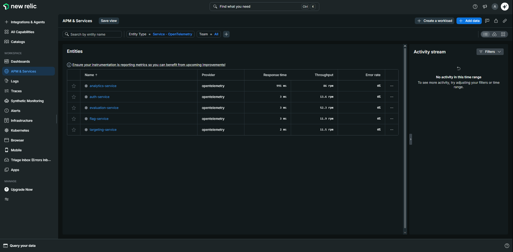</p>

<p align="center">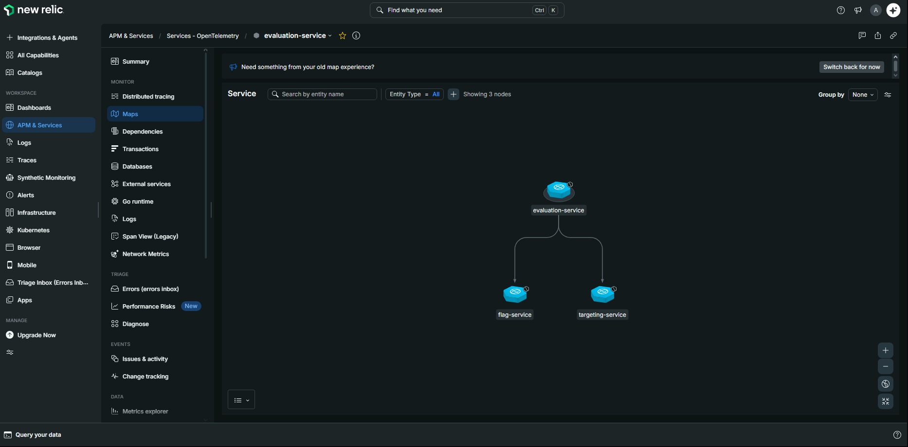</p>

<p align="center">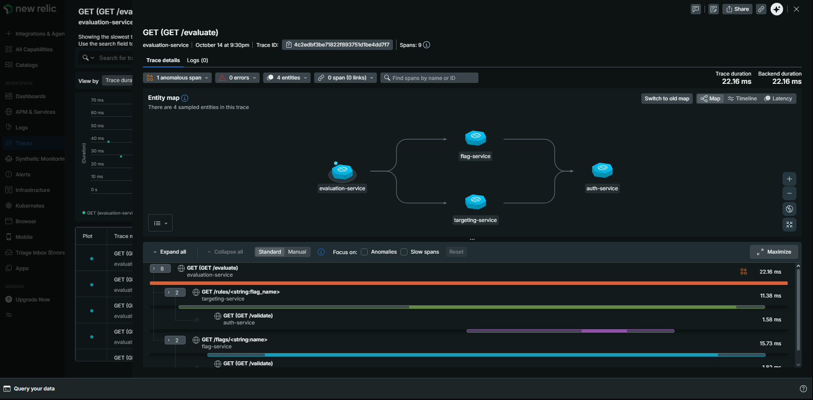</p>

---

## 🔴 Requisito 4 · Alertas, Incidente, ChatOps e Self-Healing

### Alertas por nível de severidade

As regras vivem numa PrometheusRule versionada ([prometheusrule-togglemaster.yaml](gitops/base/observability/prometheusrule-togglemaster.yaml)). A taxonomia segue a aula de Monitoramento Ativo e Alert Fatigue: nem todo alerta deve acordar uma pessoa.

| Nível | Severidade | Destino |
|---|---|---|
| N4 · Informativo | `info` | descartado (vai para dashboard, não para alerta) |
| N3 · Aviso | `warning` | Discord, canal geral |
| N2 · Crítico | `critical` | Discord, canal geral, e o responder de self-healing |
| N1 · Emergência | `emergency` | PagerDuty e Discord, canal de emergência |

Cada incidente tem **um par de regras** com a mesma condição e janelas diferentes. A primeira dispara cedo no Nível 2 e aciona a automação; a segunda só dispara se o problema persistir, e escala para o Nível 1. É assim que o escalonamento acontece porque a automação falhou, e não em paralelo a ela.

| Regra | Condição | Janela | Nível |
|---|---|---|---|
| `ToggleMasterServiceDown` | o deployment deveria ter réplicas e nenhuma está disponível | 2 min | N2 |
| `ToggleMasterServiceDownSustained` | a mesma | 7 min | N1 |
| `ToggleMasterHighErrorRate` | mais de 5% de respostas 5xx | 5 min | N2 |
| `ToggleMasterHighErrorRateSustained` | a mesma | 20 min | N1 |

A regra de indisponibilidade compara réplicas disponíveis com réplicas desejadas. Por isso ela não dispara para Jobs concluídos nem para o analytics-service, que o KEDA mantém em zero réplicas de propósito quando a fila está vazia.

### Roteamento e inibição no Alertmanager

O roteamento está em [kube-prometheus-stack.yaml](gitops/apps/kube-prometheus-stack.yaml). As credenciais do PagerDuty e dos dois webhooks do Discord são lidas de arquivos montados a partir de um Secret (`alertmanager-integrations`), pelos campos `service_key_file` e `webhook_url_file`, então nenhuma delas entra no Git.

Duas regras de inibição evitam ruído. Quando o Nível 1 de um incidente dispara, ele silencia o Nível 2 do mesmo incidente. E enquanto um serviço estiver fora do ar, os alertas de taxa de erro do mesmo nível ficam suprimidos: se o flag-service cai, o evaluation-service passa a devolver 502 por depender dele, e sem essa inibição o responder reiniciaria um serviço saudável. Para cobrir o tempo que a janela de cinco minutos da taxa de erro leva para esvaziar depois da recuperação, o alerta de indisponibilidade continua ativo por mais seis minutos (`keep_firing_for`).

### Incidente e ChatOps

O **PagerDuty** recebe os alertas de Nível 1 pela Events API e abre o incidente com urgência alta; quando o alerta para de disparar, o Alertmanager envia a resolução e o incidente fecha sozinho. O **Discord** tem dois canais, um geral e um de emergência, porque a aula de Notificação e Interação recomenda segmentar canais por severidade. As mensagens já trazem o serviço afetado, o impacto, a próxima ação e o link do runbook, para que ninguém precise montar o contexto do zero.

### Self-healing

A automação é um **responder que roda dentro do cluster** ([self-healing-responder.yaml](gitops/base/observability/self-healing-responder.yaml) e [self-healing-code.yaml](gitops/base/observability/self-healing-code.yaml)). Ele recebe o webhook do Alertmanager e percorre quatro etapas, cada uma registrada em log estruturado:

1. **recebido:** identifica o deployment afetado pelo label `deployment` do alerta.
2. **validação:** confirma que o deployment existe, que tem réplicas desejadas e que não houve outra ação nos últimos 30 minutos.
3. **ação executada:** faz o rollout restart, o mesmo que o `kubectl rollout restart`, pela API do Kubernetes.
4. **verificação:** lê o estado das réplicas logo depois da ação.

O responder usa uma ServiceAccount com uma Role restrita ao namespace da aplicação e aos verbos `get`, `list` e `patch` em deployments. O código está versionado no Git como ConfigMap, o que dá auditoria de qualquer mudança na automação. O intervalo de espera de 30 minutos impede que uma ação ineficaz vire um loop de reinícios: se o restart não resolver, o caso segue para o plantonista. E os [runbooks](runbooks/), linkados em cada alerta, descrevem o que fazer em cada camada da resposta.

O enunciado sugere, como exemplo, um GitHub Action acionado por webhook. A escolha por um responder no próprio cluster tem quatro razões: menos saltos entre o alerta e a ação, nenhuma dependência externa justamente durante um incidente, autorização pelo RBAC nativo do Kubernetes com menor privilégio, e nenhuma credencial estática fora do cluster.

### A prova real

O incidente demonstrado no vídeo remove o Secret com as credenciais do banco do flag-service e apaga os pods em execução, o que equivale a cortar o serviço do seu banco. A sequência observada:

| Momento | O que aconteceu |
|---|---|
| T+0 | o pod recriado fica preso em `CreateContainerConfigError` |
| ~T+3 min | `ToggleMasterServiceDown` em Firing; mensagem de Nível 2 no Discord |
| no mesmo segundo | o responder valida e executa o restart, criando um ReplicaSet novo |
| logo depois | o pod criado pela automação falha pelo mesmo motivo, porque a causa é de configuração |
| ~T+8 min | escala para o Nível 1: incidente aberto no PagerDuty e aviso no canal de emergência |
| após restaurar | resolução automática no Discord e incidente fechado sozinho no PagerDuty, com duração de 5 minutos |

<p align="center">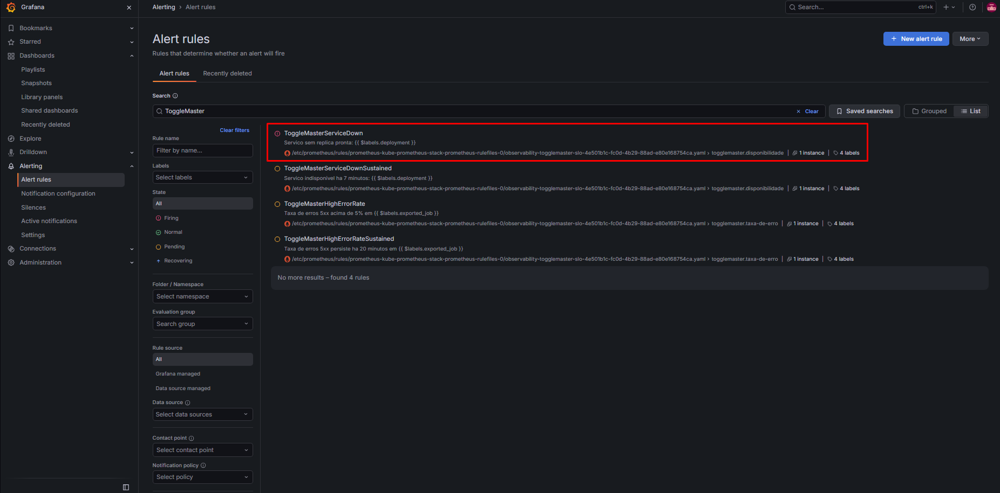</p>

<p align="center">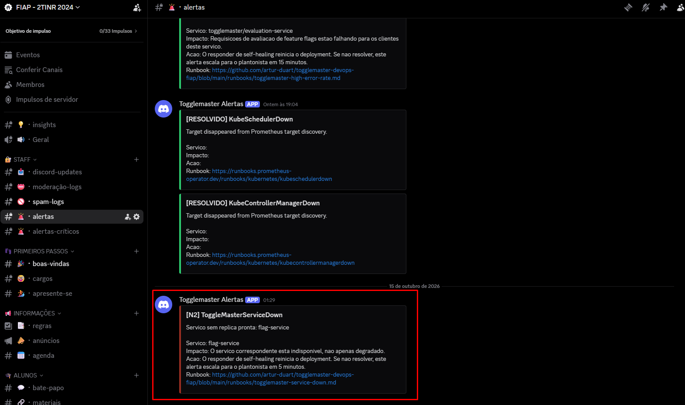</p>

<p align="center">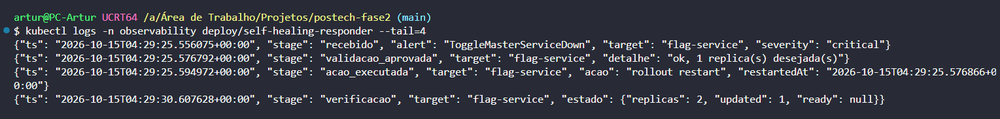</p>

<p align="center">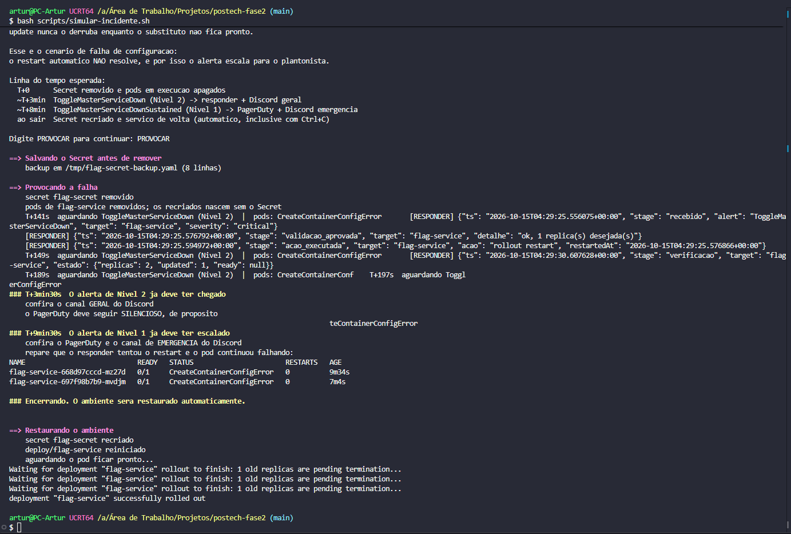</p>

<p align="center">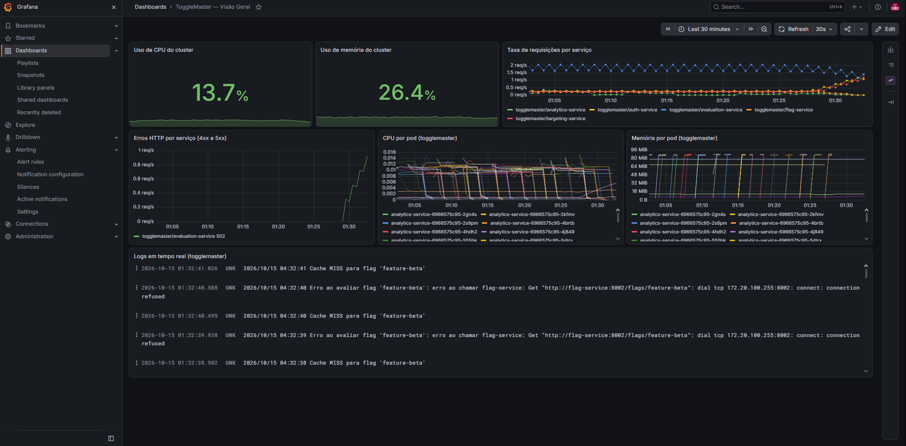</p>

<p align="center">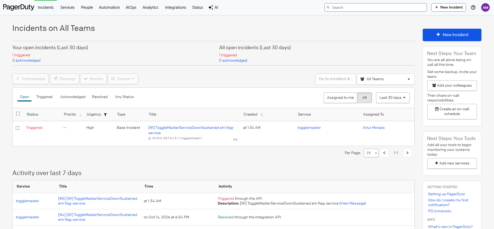</p>

<p align="center">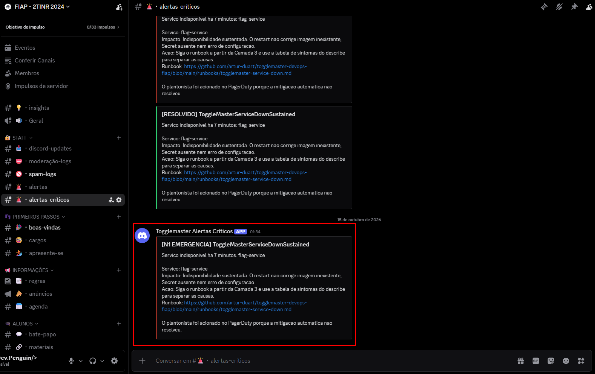</p>

<p align="center">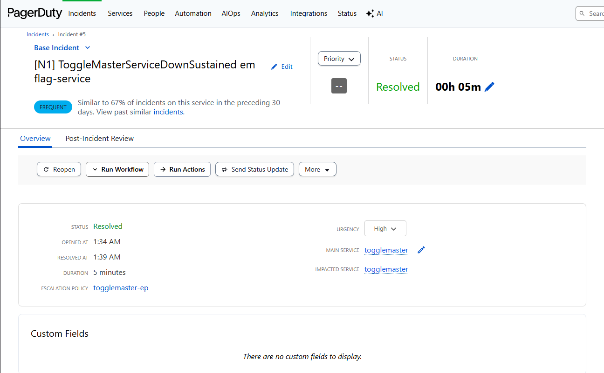</p>

---

## 🧭 Justificativa Técnica das Escolhas

**Arquitetura do OpenTelemetry.** Um único Collector central recebe todos os sinais em OTLP e os roteia por pipeline. Isso desacopla as aplicações das ferramentas de destino, permite processar a telemetria num só lugar (limite de memória e agrupamento em lote) e evita que cada serviço precise conhecer o New Relic ou o Prometheus. Os logs são a exceção deliberada: o Alloy, que é uma distribuição do mesmo Collector, os coleta da saída dos containers, cobrindo também os componentes que não foram instrumentados.

**New Relic no lugar do Datadog.** O plano gratuito do New Relic inclui APM, tracing distribuído e Service Map sem limite de tempo, e ele recebe OTLP nativamente, sem agente proprietário. No Datadog, o APM só está disponível no período de teste. Como a instrumentação é toda OpenTelemetry, a escolha do APM fica isolada na configuração do Collector.

**PagerDuty no lugar do OpsGenie.** A aula de MTTR com OpsGenie compara as duas ferramentas e posiciona o PagerDuty para quem precisa de orquestração de resposta, automação de runbooks e remediação automática, que é exatamente o caso deste projeto. Além disso, o OpsGenie está em processo de descontinuação pela Atlassian.

**Discord no ChatOps.** Tem integração nativa no Alertmanager por webhook, sem instalar aplicativo, e permite separar um canal por nível de severidade.

---

## ✅ Rastreabilidade dos Requisitos

### Código-fonte no repositório

| Exigência | Onde está |
|---|---|
| IaC/GitOps atualizado com a stack de monitoramento | [gitops/apps/](gitops/apps/) (`kube-prometheus-stack`, `loki`, `alloy`, `observability-base`) e [gitops/base/observability/](gitops/base/observability/) |
| IaC/GitOps atualizado com o OTel Collector | [gitops/apps/otel-collector.yaml](gitops/apps/otel-collector.yaml) |
| Aplicações instrumentadas | `tracing.go` em [auth-service](services/auth-service/tracing.go) e [evaluation-service](services/evaluation-service/tracing.go); `requirements.txt` e `Dockerfile` dos três serviços Python |
| Automações de self-healing | [self-healing-responder.yaml](gitops/base/observability/self-healing-responder.yaml), [self-healing-code.yaml](gitops/base/observability/self-healing-code.yaml) e os [runbooks](runbooks/) |

### Vídeo de demonstração

| Exigência | Onde aparece |
|---|---|
| EKS e ArgoCD rodando com a nova stack | onze Applications `Synced` e `Healthy` |
| Dashboard customizado no Grafana | painel saudável e o mesmo painel durante o incidente |
| Busca de logs no Loki | consulta por namespace e consulta dos erros em cascata |
| Explicação do roteamento do OTel Collector | cena de arquitetura |
| Service Map no APM | New Relic, centrado no evaluation-service |
| Requisição de teste e trace distribuído | nove spans, quatro serviços, sem erros |
| Problema proposital no sistema | Secret do banco removido do flag-service |
| Alerta em Firing no Grafana | `ToggleMasterServiceDown` em Firing |
| Incidente no PagerDuty e notificação no Discord | Nível 1 aberto no PagerDuty; Níveis 2 e 1 nos dois canais |
| Self-healing executando a ação corretiva | logs do responder e o pod recriado pela automação |

### Relatório de entrega

| Exigência | Onde está |
|---|---|
| Print do dashboard do Grafana | [16-grafana-incidente.png](assets/fase4/16-grafana-incidente.png) |
| Print de um trace distribuído no APM | [08-newrelic-trace.png](assets/fase4/08-newrelic-trace.png) |
| Print da notificação no ChatOps | [12-discord-nivel2.png](assets/fase4/12-discord-nivel2.png) e [18-discord-nivel1.png](assets/fase4/18-discord-nivel1.png) |
| Print da execução do self-healing | [13-self-healing-responder.png](assets/fase4/13-self-healing-responder.png) |
| Justificativa técnica | seção [Justificativa Técnica das Escolhas](#-justificativa-técnica-das-escolhas) |

---

## 🚀 Como Reproduzir do Zero

> Pré-requisitos: AWS CLI configurado (conta pessoal), Terraform 1.10 ou superior, `kubectl`, Python e Docker. Contas no New Relic, no PagerDuty (Service com integração Events API) e um servidor no Discord com dois webhooks de canal.

### 1. Recursos persistentes (uma única vez)

```bash
terraform -chdir=infra/persistent init
terraform -chdir=infra/persistent apply
```

Cria os repositórios ECR e a federação OIDC do GitHub Actions. Eles ficam em um stack separado para sobreviver aos ciclos de `destroy`: assim o CI continua funcionando com o cluster desligado e as imagens não precisam ser reconstruídas a cada subida.

### 2. Infraestrutura do ambiente

```bash
terraform -chdir=infra init
terraform -chdir=infra apply
```

No primeiro `apply` de um cluster novo, os recursos que tocam o Kubernetes podem falhar com `namespaces is forbidden`, porque a entrada de acesso do EKS leva alguns segundos para propagar. Basta rodar o `apply` de novo.

### 3. Segredos e bootstrap

```bash
cp scripts/secrets.env.example ~/.togglemaster-secrets.env   # preencha os valores
bash scripts/bootstrap-cluster.sh
```

O [script](scripts/bootstrap-cluster.sh) aponta o `kubectl` para o cluster, atualiza o endpoint do Redis no GitOps, busca as senhas do RDS no Secrets Manager, cria os sete Secrets (aplicação, New Relic, integrações do Alertmanager e Grafana) e aplica as Applications do ArgoCD. Os segredos ficam fora do repositório.

### 4. Ensaiar e provocar o incidente

```bash
bash scripts/ensaio-alertas.sh        # sem cluster: Alertmanager real em Docker, entrega de verdade no PagerDuty e no Discord
bash scripts/simular-incidente.sh     # no cluster: derruba o flag-service e restaura ao final
```

### 5. Derrubar o ambiente

```bash
terraform -chdir=infra destroy
```

Se o `destroy` parar no namespace da aplicação, é o finalizer do KEDA, que já foi desinstalado e não pode mais removê-lo:

```bash
for r in $(kubectl get scaledobject,triggerauthentication -n togglemaster -o name); do
  kubectl patch $r -n togglemaster --type=merge -p '{"metadata":{"finalizers":null}}'
done
```

---

## 🚧 Desafios e Decisões Técnicas

Toda a configuração foi validada antes de subir o cluster, com o `promtool` (regras), o `amtool` (roteamento do Alertmanager, inclusive testando caminho a caminho) e o `helm template` (o que cada chart realmente gera). Ainda assim, o ambiente real revelou problemas que nenhuma validação estática pegaria. Os principais:

- **A causa real dos 502 apareceu no Loki.** O painel de logs mostrou `relation "api_keys" does not exist`: o schema dos bancos nunca era carregado. A solução foram Jobs de migração como hooks `PreSync` do ArgoCD, que rodam antes de cada sincronização. Foi a observabilidade pagando a si mesma na primeira semana.
- **Regras que o Prometheus não enxergava.** O seletor padrão do chart só descobre regras com o label do próprio release. Dezenove grupos de regras estavam carregados, e nenhum era do projeto.
- **Um alerta medindo o sintoma errado.** A primeira versão contava containers não prontos em todos os pods, e os Jobs de migração concluídos disparavam um falso alerta de indisponibilidade. A versão final compara réplicas disponíveis com desejadas.
- **O ensaio que não derrubava nada.** Remover o Secret e reiniciar o deployment não tirava o serviço do ar: o pod antigo já tinha as credenciais carregadas, e com uma réplica o rolling update se recusa a derrubá-lo antes de o novo ficar pronto. O alerta estava certo em não disparar; o ensaio passou a apagar os pods.
- **O responder mirando o alvo errado.** Os alertas baseados no kube-state-metrics carregam o nome do pod do próprio exportador, e o responder o usava antes do label `deployment`. A validação recusou a ação, como devia, e a ordem de precedência foi corrigida.
- **Duas convenções de métrica convivendo.** A instrumentação Python emite `http_server_duration_milliseconds` e a Go emite `http_server_request_duration_seconds`, com nomes de label diferentes. Dashboard e alertas passaram a ler as duas.
- **A inibição falhando na volta ao normal.** Mesmo com o alerta de indisponibilidade mantido ativo após a recuperação, o responder reiniciou o evaluation-service depois do incidente. Lendo o código-fonte do Alertmanager 0.34, a causa ficou clara: as origens de inibição são indexadas pelos labels de `equal`, uma por chave, sem procurar outra. Sem `equal`, os dois níveis disputavam a mesma vaga, e quando o Nível 1 se resolvia a vaga ficava apontando para um alerta encerrado. A correção (`equal: [nivel]`) foi comprovada com um teste reproduzível contra o Alertmanager do cluster, antes e depois.
- **Ruído que nasce do próprio chart.** No EKS, `KubeSchedulerDown` e `KubeControllerManagerDown` disparavam o tempo todo, porque esses componentes são gerenciados pela AWS. Alerta que nunca pode ser resolvido é o exemplo clássico de alerta não acionável.
- **Propagação de contexto em Go.** A instrumentação sozinha não produzia traces distribuídos; foi preciso propagar o contexto da requisição por toda a cadeia de chamadas do evaluation-service.
- **Identidade e registro fora do ciclo descartável.** O OIDC do GitHub e os ECR eram destruídos junto com o cluster, e o CI falhava com uma mensagem enganosa sobre o token. Separar o que é plataforma do que é ambiente resolveu.

---

## 💰 Disciplina de Custo (FinOps)

O projeto usa dois stacks de Terraform com ciclos de vida diferentes. O de [infra/](infra/) contém tudo o que é cobrado por hora (EKS, nós, RDS, ElastiCache, NAT Gateway e Load Balancer), sobe apenas para validar e gravar, e é derrubado com `terraform destroy` ao fim de cada sessão. O de [infra/persistent/](infra/persistent/) contém só os repositórios ECR e a federação OIDC, que custam centavos por mês e permanecem de pé até o fim do projeto.

A maior parte do trabalho da fase foi feita sem cluster: as configurações foram validadas com as próprias ferramentas do Prometheus e do Alertmanager, e a cadeia de alertas foi ensaiada inteira com o Alertmanager rodando em Docker, entregando de verdade no PagerDuty e no Discord. O cluster só subiu para provar o que dependia do ambiente real. Ao final de cada sessão, a conta foi verificada recurso a recurso para confirmar que nada cobrado por hora havia ficado ligado.

---

## 📦 Entregáveis da Fase 4

- 🎥 **Vídeo de demonstração** (até 25 min): **[link a inserir]**
- 💻 **Código-fonte:** a stack de observabilidade e o Collector ([gitops/](gitops/)), a instrumentação ([services/](services/)), as automações ([gitops/base/observability/](gitops/base/observability/), [scripts/](scripts/) e [runbooks/](runbooks/)).
- 📄 **Relatório de entrega (PDF):** com as evidências visuais e a justificativa técnica.

---

## 🏷 Versionamento

- `v1.0.0-fase1`: MVP monolítico (EC2 + RDS).
- `v2.0.0-fase2`: microsserviços em Kubernetes/EKS.
- `v3.0.0-fase3`: IaC com Terraform, CI/CD DevSecOps e GitOps com ArgoCD.
- `v4.0.0-fase4`: observabilidade com OpenTelemetry, APM, alertas, incidente e self-healing.

---

## 👤 Autor

**Artur Duarte de Moraes** · RM 370569
IT Operation Engineer no Banco Bradesco · Pós-graduando em DevOps & Cloud Architecture (FIAP)

[](https://www.linkedin.com/in/artur-duarte-5141aa212)
[](https://github.com/artur-duart)
